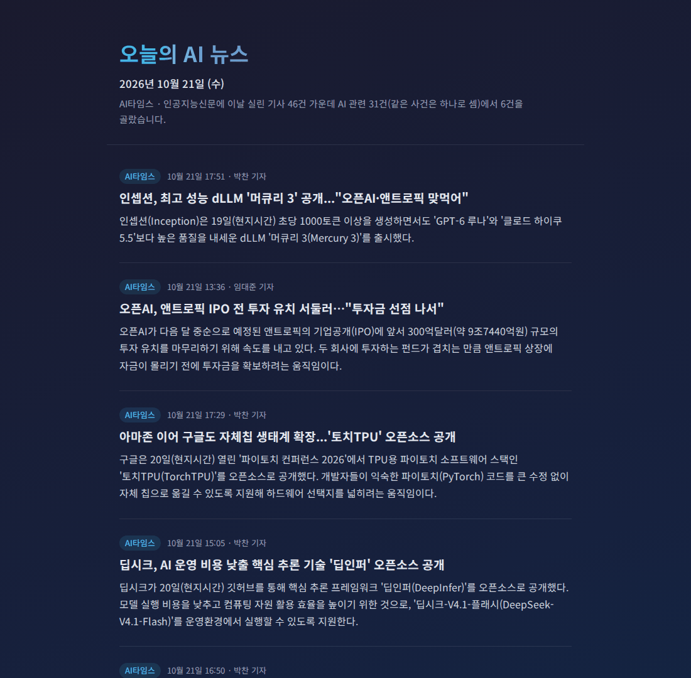

# AI News Today (오늘의 AI 뉴스)

A small daily digest of Korean AI news, built from the RSS feeds of two Korean AI outlets, AI타임스 and 인공지능신문. A script collects one day of articles, a model picks the most important stories and summarizes each in one or two sentences, and the result is a static page where every item links to the original article.



The repo started in December 2025 as a single hand-made page with screenshots of three articles. It is now a reproducible pipeline, and the site shows whatever editions are committed in `editions/`.

## How it works

1. **Collect** (`digest/feeds.py`): fetch both feeds and keep items published on the requested day in KST. Items without a date or link are dropped rather than guessed.
2. **Filter and group** (`digest/select.py`): skip regional desk posts, bulletins and columns, and items that do not mention AI. The same story from different outlets is merged by title similarity (character bigrams plus quoted names).
3. **Pick** (`digest/llm.py`): the model sees candidate titles and ledes and returns up to six candidate ids. It never writes titles, links, outlets or dates; those come from the feeds. If it picks nothing, no edition is written.
4. **Summarize** (`digest/summarize.py`): the model gets the titles and RSS descriptions of the story's articles and must return the source phrases it relied on. The summary is dropped if one of those phrases is not in the source or if it contains a number the source does not have. That catches invented quotes and figures, not a changed meaning, so it is a filter rather than a fact check. Dropped summaries (and failed model calls) are replaced by the first sentences of the publisher's description, marked "기사 리드".
5. **Render** (`digest/render.py`): `editions/YYYY-MM-DD.json` becomes `public/` (`index.html` is the latest edition, plus one page per date).

Summaries are based on the RSS title and description, the lede the outlet itself publishes, not on the full article.

## Running

Python 3.11 or newer.

```bash
pip install -r requirements.txt
export OPENAI_API_KEY=...                        # or pass --no-model
python -m digest build                           # yesterday, KST
python -m digest build --date 2026-10-21 --force # rebuild a given day
python -m digest render                          # public/ from editions/, no network
```

`--no-model` ranks stories by how many outlets covered them and uses the publisher's lede, so it runs without an API key. The model defaults to `gpt-6.1-sol`; set `DIGEST_MODEL` to use another one. Model answers that pass the checks are cached in `.cache/` by their exact input, so rebuilding a day from unchanged feed text does not call the API again. A day takes about seven model requests.

Tests run offline against fixture feeds:

```bash
pip install -r requirements-dev.txt
pytest
```

## Publishing

`public/` is a plain static site. `vercel.json` points Vercel at it, so `vercel --prod` from the repo root deploys the latest committed edition; any static host works too. The live site at https://ai-news-today.vercel.app is deployed by hand and does not update on push.

`.github/workflows/edition.yml` runs the tests, builds yesterday's edition (or a given date) and commits it when started from the Actions tab; it skips a date that already exists. The schedule is commented out. To get a new edition every morning, enable it and add an `OPENAI_API_KEY` repository secret; without the secret it builds a lede-only edition and calls no model. Deploying `public/` stays a separate step.

## Limits

- The feeds keep only their latest 50 or so items, so a day has to be built within roughly a day. The page says so when a feed no longer reached back to the start of the day.
- Both outlets are Korean AI trade press, and the picks reflect what they cover.
- The checks catch invented quotes and numbers, not paraphrasing mistakes. The first edition was compared with its sources by hand, and new editions deserve the same look before they go out.

## 한국어 요약

AI타임스와 인공지능신문 RSS에서 하루치 AI 기사를 모아 같은 사건을 묶고, 모델이 고른 기사를 RSS 제목과 설명문만 근거로 한두 문장으로 요약해 정적 페이지로 만듭니다. 모든 항목은 원문 기사로 연결되고, 요약에 쓴 인용 구절이나 숫자가 설명문에 없으면 요약 대신 기사 첫 문장을 싣습니다. 이 검사는 지어낸 인용과 숫자를 거르는 정도이고 의미까지 확인하지는 않습니다. `python -m digest build`로 전날 KST 기준 판을 만들고, 키 없이 돌릴 때는 `--no-model`을 붙입니다.

## License

MIT
